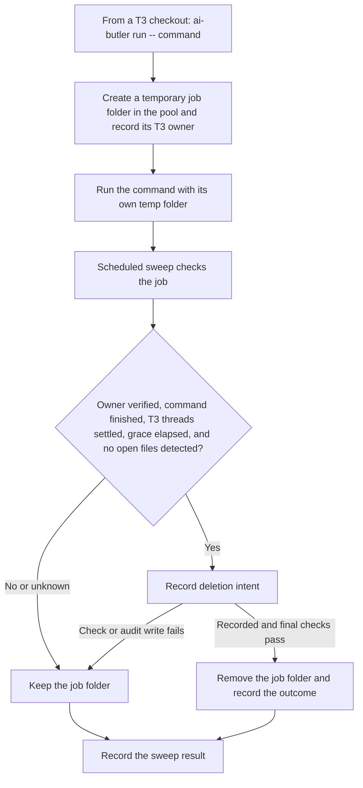

# AI Butler

AI Butler is a macOS CLI for disposable scratch owned by T3 jobs. It does not
manage source worktrees, shared build caches, device state, or existing artifacts.

## What is a scratch pool?

A **scratch pool** is a folder AI Butler checks for temporary job folders.
The default pool is named `tmp`; you don't need to add one. From a T3 checkout,
run `ai-butler run -- <command>` to give that command its own folder inside
the pool. AI Butler sets `TMPDIR` and `AGENT_TMP_DIR` for the command and
records which T3 thread owns the folder.

AI Butler only cleans up job folders it created and registered. Adding a pool
doesn't make existing files eligible for cleanup. Commands run outside
`ai-butler run` do not opt in. Use `ai-butler list` to see your pool paths.

## How cleanup works

The sweep runs hourly by default. A finished command can still have an
unsettled T3 thread, so finishing the command alone doesn't trigger deletion.
Use `ai-butler preview` to see what a sweep would keep or remove.

## Install

Requires macOS, a logged-in user session, Python 3.9 or later, and a local T3
installation. No Python packages are required.

~~~sh
brew tap ipavlidakis/tap
brew trust --formula ipavlidakis/tap/ai-butler
brew install ipavlidakis/tap/ai-butler
ai-butler install
ai-butler status
~~~

Only use the trust command on Homebrew versions that require formula trust.
`ai-butler install` registers the per-user LaunchAgent. Run
`ai-butler uninstall` before removing the formula with Homebrew.

For a source checkout, use `./ai-butler` and keep the checkout at a stable path
while its LaunchAgent is installed.

## Commands

| Command | Behavior |
| --- | --- |
| `list` | Show configured absolute paths, effective timing settings, and the config file location. An optional `--json` serves scripts. |
| `add <path>` | Register a new or empty pool under the dedicated disposable root. Never adopt an arbitrary path or existing files. |
| `remove <path>` | Stop allocating and sweeping that pool. Leave the directory and its contents on disk. |
| `install` | Create and load the user's LaunchAgent if needed. Running it twice is safe. |
| `uninstall` | Unload and remove the LaunchAgent. Keep the configuration and disk data. |
| `setInterval <minutes>` | Change the sweep interval. `0` restores the default of 60 minutes. Reload the installed service to apply it. |
| `setSettlementGracePeriod <minutes>` | Change the minimum time after both the foreground command finishes and T3 settles its thread. Keep the prototype's five-minute default. If work resumes, recalculate eligibility from the new settlement. |
| `setLogRetention <days>` | Keep that many calendar days of audit logs, including today (UTC). Default: seven. Expired logs are removed on the next scheduled sweep. |
| `run [--thread <id>] [--pool <name>] -- <command>` | From the T3 checkout, opt in one foreground command. Uses `T3CODE_THREAD_ID` by default. |
| `preview` | List what a sweep would keep or remove, with reasons, without deleting data. |
| `status` | Show whether the LaunchAgent is loaded and the time and outcome of its last sweep. |

## Local settings and data

- Settings: `~/.config/ai-butler/config.json`. The CLI creates it locally on
  install or the first settings change. Use the CLI to make changes so a
  running sweeper sees them safely and an interval change reloads launchd.
- LaunchAgent: `~/Library/LaunchAgents/com.local.ai-butler.plist`.
- Latest sweep and audit history: run `ai-butler status` to see their
  paths. By default, both live in
  `~/Library/Application Support/AI Butler/State/`.
  Each UTC day gets a separate `YYYY-MM-DD.jsonl` file. Use
  `ai-butler setLogRetention 14` to keep two weeks, for example.
  It records every scheduled sweep and the path, owner, reason, and outcome
  for each deletion. AI Butler writes a durable intent before removing a job.
  To view recent events, run
  `tail -n 20 "$HOME/Library/Application Support/AI Butler/State/audit/$(date -u +%F).jsonl"`.
  An intent without an outcome means there was an interruption; inspect that
  path to see whether it still exists. The audit trail is local and does not
  store a backup of deleted files.

Add another pool only if you want to group jobs separately. Run `ai-butler list --json`
to find the scratch root (`deletion_boundary`), then pass the full path of
a new or empty folder directly inside it to `ai-butler add`. Use
`ai-butler run --pool <name> -- <command>` to allocate jobs there. Names
start with a lowercase letter and may contain
lowercase letters, digits, and hyphens. `remove` stops watching that folder
and leaves its contents in place.

If you need a different storage location, set `scratch_root` and/or
`state_directory` in your local config to separate absolute paths under
your home directory. Stop the service before changing paths. Changing a root
does not move or delete existing files.

The configuration, plist, T3 database, and reports are local runtime data. They
are not part of the repository. The earlier prototype uses a separate label,
config, and pool. This tool does not migrate that installation.

## Cleanup rules

`run` supplies `TMPDIR` and `AGENT_TMP_DIR` to the foreground command. Don't
store deliverables there, hand paths to detached jobs, or reuse the paths in
later commands. AI Butler only removes paths it allocated in a registered
pool. It checks read-only local T3 state, waits for settlement and command
completion plus the grace period, and preserves active, unfinished, open, or
unrecognized jobs. If it cannot read the T3 schema or match a thread, it keeps
the data. Missing configuration disables scheduled cleanup. A command
interrupted before its completion can be recorded is also kept. T3 remains
responsible for source worktree removal.

## Checks

Run `python3 check-agent-scratch.py /absolute/path/to/test-scratch` for the
scratch lifecycle fixtures. Run `python3 check-ai-butler.py /absolute/path/to/test-scratch`
for the configuration and LaunchAgent fixture.
Pass `--live-lsof` to the scratch check to test actual open-file detection during
deletion. If lsof warns that a filesystem cannot be inspected, the sweeper
keeps the job.
