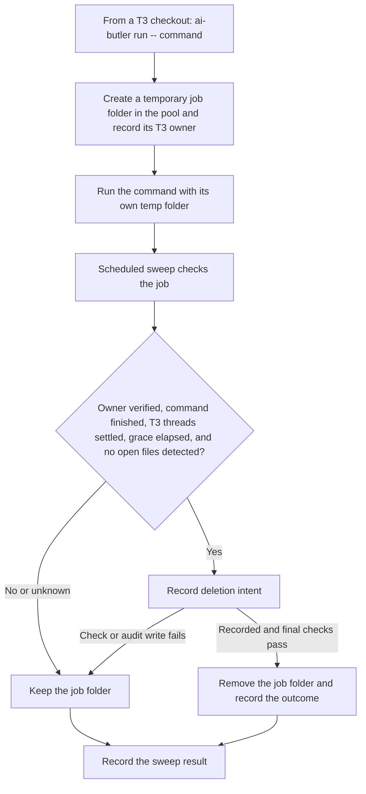

# AI Butler

AI Butler is a macOS CLI that cleans up temporary files, Xcode DerivedData
built from T3 worktrees and, with startup hooks enabled, build output owned by
T3 worktrees, including build output left inside them. Source worktrees, shared caches, device state, and older
unregistered data stay outside its scope.

## Install

Requires macOS, a logged-in user session, Python 3.9 or later, and a local T3
installation. No Python packages are required.

~~~sh
brew tap ipavlidakis/tap
brew trust --formula ipavlidakis/tap/ai-butler
brew install ipavlidakis/tap/ai-butler
~~~

Only use the trust command on Homebrew versions that require formula trust.
`ai-butler install` registers the per-user LaunchAgent. Run
`ai-butler uninstall` before removing the formula with Homebrew.

For a source checkout, use `./ai-butler` and keep the checkout at a stable path
while its LaunchAgent is installed.

## First run

1. Run `ai-butler list` to find the configured storage paths and cleanup interval.
2. Run `ai-butler preview --summary` for reclaimable space, the five largest eligible paths and grouped keep reasons. Use `ai-butler explain PATH` for one folder or a file inside it. Plain `preview` prints JSON for scripts.
3. Run `ai-butler install --hooks` to enable scheduled cleanup and route build output from new agent sessions. In a fresh agent session, source the hook-provided `env.sh` and run `ai-butler status --summary` to verify the service, provider hooks and loaded run environment.

A process that names a candidate's absolute path on its command line can keep it in use even with no open file. Preview identifies this reason. For ignored in-worktree build folders, AI Butler also checks nested Git repositories. A SwiftPM checkout must match its lockfile revision and remote, with clean files and verifiable history. Extra branch history, including history in a mirror outside the pinned commit's ancestry, keeps the cache for review.

## What is a scratch pool?

A **scratch pool** is a folder AI Butler checks for temporary job folders.
The default pool is named `tmp`; you don't need to add one. From a T3 checkout,
run `ai-butler run -- <command>` to give that command its own folder inside
the pool. AI Butler sets `TMPDIR` and `AGENT_TMP_DIR` for the command and
records which T3 thread owns the folder.

AI Butler only cleans up job folders it created and registered. Adding a pool
doesn't make existing files eligible for cleanup. Commands run outside
`ai-butler run` do not opt in. Use `ai-butler list` to see your pool paths.

## How cleanup works

The sweep runs hourly by default. A finished command can still have an
unsettled T3 thread, so finishing the command alone doesn't trigger deletion.
Use `ai-butler preview` to see what a sweep would keep or remove.

## Worktree build cleanup

`ai-butler install --hooks` registers the artifact startup hook for Codex,
Claude Code, Cursor and Antigravity when their configuration directories
exist. If Codex asks you to trust the new hook, review it in `/hooks`. Start a
fresh agent session after installing. Plain `install` does not change provider
settings.

T3 runs Antigravity with a private profile for each Antigravity instance
(`~/.t3/userdata/providers/antigravity/<instance>`), which does not read
`~/.gemini`. `install --hooks` writes the hooks to `~/.gemini/config/hooks.json`
and to every T3 Antigravity profile that exists. Run it again after you add an
Antigravity instance in T3. Antigravity hooks cannot set environment
variables, so its startup hook tells the agent which `env.sh` to source.

For Codex, Claude Code and Antigravity, `install --hooks` also adds a
PreToolUse guard. It blocks an `xcodebuild` call run from a T3 worktree
without `-derivedDataPath`, because Xcode would write that output to the
shared DerivedData folder. This includes `-list`, `-showBuildSettings` and
`-resolvePackageDependencies`, which resolve packages there. Information
flags such as `-version` and `-showsdks` pass. The guard reads only the shell
command line, so a script that calls `xcodebuild` is not checked; the
DerivedData sweep below still cleans up after it.

The hook creates an `owner.json` that records the checkout path, and an
`env.sh` with a shared build path for that checkout and separate evidence
paths for each run. Source that file as instructed by the hook and use the
build tool's output settings. You do not wrap normal builds in `ai-butler run`
or mark paths by hand. When the last T3 thread for the worktree settles and the
grace period passes, the next sweep checks for active work and open files
before retiring the build cache. A completed command alone is not enough.

For example:

- **Make and RepoCLI:** If the wrapper already uses the assigned agent paths
  (as Vesputio does), keep running the same Make commands.
- **Xcode and Fastlane:** Route DerivedData to a toolchain-specific directory
  in `AGENT_XCODE_DIR` and results to `AGENT_RESULTS_DIR`. For Fastlane Scan,
  `SCAN_DERIVED_DATA_PATH` and `SCAN_OUTPUT_DIRECTORY` can set this in a local
  wrapper when the lane does not pass explicit values.
- **GN and Ninja:** Use the existing build output option to route disposable
  output into `$AGENT_WORKSPACE_ARTIFACTS/build/native` if the tool supports
  it. For a Make wrapper that supports `OUT` and `PRODUCTS`, put `OUT`
  there and set `PRODUCTS` to a separate evidence or delivery path. Keep
  packages and deliverables outside the build directory.

Only workspaces newly allocated by this hook can opt in. The sweeper uses
the T3 worktree root at `~/workspace/worktrees` and leaves the build output of
older workspaces and main checkouts alone. Run evidence follows its own
retention rule below. Set a private storage location with
`install --hooks --artifact-root <path>`, or use the default under macOS
Application Support. Use `preview` to inspect eligibility.

## Xcode DerivedData

Tools such as Fastlane build into Xcode's DerivedData folder unless they are
given another path. AI Butler checks that folder on every sweep. No setup is
needed. It uses the location set in Xcode (`IDECustomDerivedDataLocation`) or
`~/Library/Developer/Xcode/DerivedData`. If Xcode keeps DerivedData inside
each workspace, the output leaves with the worktree and there is nothing to
check.

Xcode names each folder `<Name>-<hash>`, where the hash comes from the path of
the project, workspace or package that was built. AI Butler finds that path in
the folder's `info.plist` (`WorkspacePath`) and checks that its hash matches
the folder name. A build that stops early, or a query such as
`xcodebuild -list`, leaves no `info.plist`. For those folders, AI Butler hashes
the projects, workspaces and package folders in each T3 worktree with that
name, and accepts exactly one match. Gitignored ones count, because tools such
as Tuist and XcodeGen generate them. AI Butler records each match in
`derived-data-owners.json` in its state folder, so the folder is still
attributed after T3 removes the worktree.

A folder is removed only when all of these are true:

- It was built from a T3 worktree under `~/workspace/worktrees`.
- Every T3 thread for that worktree, and its descendants, is settled past the
  grace period. If the worktree and all its threads are gone, the folder is an
  orphan and is removed.
- `lsof` reports no open files in it.

Folders built from main checkouts or other paths, folders that can't be
attributed, and shared folders such as `ModuleCache.noindex` are kept. Test
results that Xcode stored inside the folder are removed with it, so copy what
you need first. AI Butler moves the folder aside before the last check, so a
new build gets a fresh folder. Each deletion gets an intent and an outcome
record in the audit log.

## Build output inside worktrees

A build run without an output path writes into the checkout: SwiftPM creates
`.build`, and `xcodebuild -derivedDataPath DerivedData` creates `DerivedData`.
SwiftPM's `.build` holds git checkouts of dependencies, and T3 keeps any
worktree that contains a nested git repository. Once you have run
`install --hooks`, AI Butler removes these two folders from a T3 worktree when
all of these are true:

- The folder is a real directory, not a symlink into the build cache.
- Git ignores it and it contains no tracked files.
- Every T3 thread for the worktree, and its descendants, is settled past the
  grace period.
- `lsof` reports no open files in it.

T3 can then apply its own rules to the rest of the worktree. Anything else in
the checkout is left alone.

## Orphaned processes

A hung test helper or build daemon can outlive the agent that started it. It
is then re-parented to launchd and keeps files open, which blocks cleanup
forever. When open files are the only reason to keep a settled build cache,
DerivedData folder or in-worktree build folder, AI Butler checks every process
holding it open. It stops them with `SIGTERM` only when each one runs as you,
has launchd as its parent, and runs from or names the folder or its worktree.
Otherwise it keeps the folder. It records the processes in a `stop_orphans`
audit event before stopping them, and removes the folder once they exit.

## Run evidence retention

Each agent session keeps its logs, results and screenshots in its own
`runs/<session>` folder in the artifact workspace. The sweep deletes a run
folder when all of these are true:

- Nothing in it changed in the last 7 days. Change the period with
  `ai-butler setEvidenceRetention <days>`. Use `0` to keep evidence until you
  remove it.
- The run's owner record matches its workspace.
- For a T3 worktree, every T3 thread for it, and its descendants, is settled
  past the grace period. A main checkout has no thread record, and a removed
  worktree has no owner left. For those, only the age and open-file checks apply.
- `lsof` reports no open files in the folder.

Each deletion gets an intent and an outcome in the audit log. Copy anything you
need to keep, such as PR evidence, out of the run folder before the period ends.

## Storage report

`ai-butler report` shows how much large locations have grown, and removes
nothing. Each scheduled sweep records the size of the artifact root and these
locations:

- `~/Library/Developer/Xcode/DerivedData`
- `~/Library/Developer/CoreSimulator`
- `/System/Library/AssetsV2` (simulator runtimes)
- `~/.simlock`
- `~/Library/Caches/org.swift.swiftpm`
- `~/.gradle`
- `~/Library/Caches/org.gradle` (shared read-only Gradle dependency cache)
- `~/.local/share/containers` (container VMs)
- `~/workspace/worktrees`

The report compares a fresh measurement with the oldest record, or with the
first record after `--since <ISO time | 6h | 2d>`. It also shows the Data
volume's use as `df` reports it. Set `report_paths` in the local config to
measure other absolute paths. The history follows the audit log retention.

## Project stray files

Some tools write output outside any path you can assign. For example, Skip
writes `/private/tmp/skip-export-<time>.txt` for every `skip export`. You can
list these patterns per project; the project is its folder name under
`~/workspace/worktrees`:

~~~sh
ai-butler addProjectCleanup vesputio-fullstack '/private/tmp/skip-export-*.txt'
ai-butler preview
ai-butler removeProjectCleanup vesputio-fullstack '/private/tmp/skip-export-*.txt'
~~~

A pattern is an existing canonical directory (use `/private/tmp`, not `/tmp`)
plus a filename glob with at least four literal characters. The directory can't
overlap worktrees, T3 scratch, or AI Butler's own storage.

These files have no ownership record, so AI Butler reads the first 64 KiB of
each match. It looks for the one worktree of that project the file names. A
match is removed only when all of these are true:

- It is a regular file you own, with a single link.
- It names exactly one worktree of the project.
- Every T3 thread for that worktree, and its descendants, is settled past the
  grace period.
- The file hasn't changed within the grace period, and `lsof` reports it isn't
  open.

If the named worktree and all its threads are already gone, the file counts as
orphaned and is removed. Files that name no worktree or several worktrees are
kept, and so is a worktree that still exists without a T3 thread. Deletions use
the same intent and outcome audit records as the other cleanup.

## Commands

| Command | Behavior |
| --- | --- |
| `list` | Show configured absolute paths, effective timing settings, and the config file location. An optional `--json` serves scripts. |
| `add <path>` | Register a new or empty pool under the dedicated disposable root. Never adopt an arbitrary path or existing files. |
| `remove <path>` | Stop allocating and sweeping that pool. Leave the directory and its contents on disk. |
| `install` | Create and load the user's LaunchAgent if needed. Running it twice is safe. |
| `install --hooks` | Also wire provider startup hooks and opt in new worktree build caches. |
| `uninstall` | Unload and remove the LaunchAgent. Keep the configuration and disk data. |
| `setInterval <minutes>` | Change the sweep interval. `0` restores the default of 60 minutes. Reload the installed service to apply it. |
| `setSettlementGracePeriod <minutes>` | Change the minimum time after both the foreground command finishes and T3 settles its thread. Keep the prototype's five-minute default. If work resumes, recalculate eligibility from the new settlement. |
| `addProjectCleanup <project> <pattern>` | Clean a project's stray tool output after the worktree it names settles. See [Project stray files](#project-stray-files). |
| `removeProjectCleanup <project> <pattern>` | Stop cleaning that pattern. Matching files stay on disk. |
| `setEvidenceRetention <days>` | Delete a run evidence folder this many days after its last change, once its owners settle. Default: seven. `0` keeps evidence. |
| `report [--since <time>] [--json]` | Show the growth of known large storage locations since a recorded sweep. Removes nothing. |
| `setLogRetention <days>` | Keep that many calendar days of audit logs, including today (UTC). Default: seven. Expired logs are removed on the next scheduled sweep. |
| `run [--thread <id>] [--pool <name>] -- <command>` | From the T3 checkout, opt in one foreground command. Uses `T3CODE_THREAD_ID` by default. |
| `explain <path>` | Show the matching rule, owner, eligibility and last recorded sweep decision. |
| `preview [--summary]` | List what a sweep would keep or remove, with reasons, without deleting data. |
| `status [--summary]` | Show whether the LaunchAgent is loaded and the time and outcome of its last sweep. |
| `artifact-hook other --cwd <path> --session <id>` | Allocate paths manually for a provider without a startup hook. |
| `guard <codex\|claude\|antigravity>` | PreToolUse hook installed by `install --hooks`. Reads the tool call on stdin and blocks `xcodebuild` without `-derivedDataPath` in T3 worktrees. |

## Local settings and data

- Settings: `~/.config/ai-butler/config.json`. The CLI creates it locally on
  install or the first settings change. Use the CLI to make changes so a
  running sweeper sees them safely and an interval change reloads launchd.
- LaunchAgent: `~/Library/LaunchAgents/com.local.ai-butler.plist`.
- Latest sweep and audit history: run `ai-butler status` to see their
  paths. By default, both live in
  `~/Library/Application Support/AI Butler/State/`.
  Each UTC day gets a separate `YYYY-MM-DD.jsonl` file. Use
  `ai-butler setLogRetention 14` to keep two weeks, for example.
  It records every scheduled sweep and the path, owner, reason, and outcome
  for each deletion. AI Butler writes a durable intent before removing a job.
  To view recent events, run
  `tail -n 20 "$HOME/Library/Application Support/AI Butler/State/audit/$(date -u +%F).jsonl"`.
  An intent without an outcome means there was an interruption; inspect that
  path to see whether it still exists. The audit trail is local and does not
  store a backup of deleted files.

Add another pool only if you want to group jobs separately. Run `ai-butler list --json`
to find the scratch root (`deletion_boundary`), then pass the full path of
a new or empty folder directly inside it to `ai-butler add`. Use
`ai-butler run --pool <name> -- <command>` to allocate jobs there. Names
start with a lowercase letter and may contain
lowercase letters, digits, and hyphens. `remove` stops watching that folder
and leaves its contents in place.

If you need a different storage location, set `scratch_root` and/or
`state_directory` in your local config to separate absolute paths under
your home directory. Stop the service before changing paths. Changing a root
does not move or delete existing files.

The configuration, plist, T3 database, and reports are local runtime data. They
are not part of the repository. The earlier prototype uses a separate label,
config, and pool. This tool does not migrate that installation.

## Cleanup rules

For disposable scratch, `run` supplies `TMPDIR` and `AGENT_TMP_DIR` to the foreground command. Don't
store deliverables there, hand paths to detached jobs, or reuse the paths in
later commands. AI Butler only removes paths it allocated in a registered
pool. It checks read-only local T3 state, waits for settlement and command
completion plus the grace period, and preserves active, unfinished, open, or
unrecognized jobs. If it cannot read the T3 schema or match a thread, it keeps
the data. Missing configuration disables scheduled cleanup. A command
interrupted before its completion can be recorded is also kept. T3 remains
responsible for source worktree removal.

Build cleanup keeps its audit trail outside the build directory. It renames
the old cache out of the way before the final check so a new build can use
the original path. If a check fails and the original path has been recreated,
the old cache is kept and reported as staged for manual review.

## Checks

Run `python3 check-agent-scratch.py /absolute/path/to/test-scratch` for the
scratch lifecycle fixtures. Run `python3 check-ai-butler.py /absolute/path/to/test-scratch`
for the configuration and LaunchAgent fixture.
Pass `--live-lsof` to the scratch check to test actual open-file detection during
deletion. If lsof warns that a filesystem cannot be inspected, the sweeper
keeps the job.
